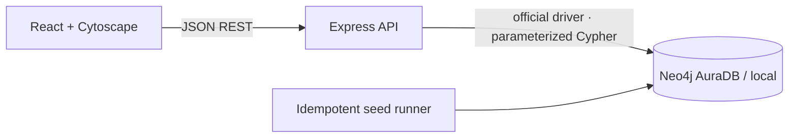

# Architecture

The React + TypeScript client renders an academic dashboard and makes bounded requests to the Express + TypeScript API. The API validates query parameters and payloads, then uses the official Neo4j JavaScript driver with parameterized Cypher. The database connection URI and credentials are read only by the backend. Cytoscape.js presents records returned by the real graph endpoint. No client mock fixtures are used as live results.

Public writes are disabled by default with `DEMO_WRITES_ENABLED=false`. Enable writes only for an isolated coursework demo database. Configure the deployed backend origin using `FRONTEND_ORIGIN`.
